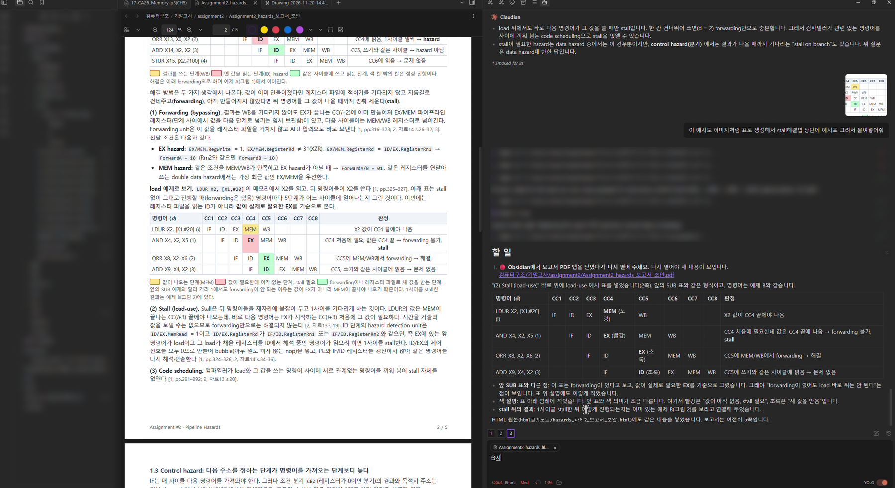
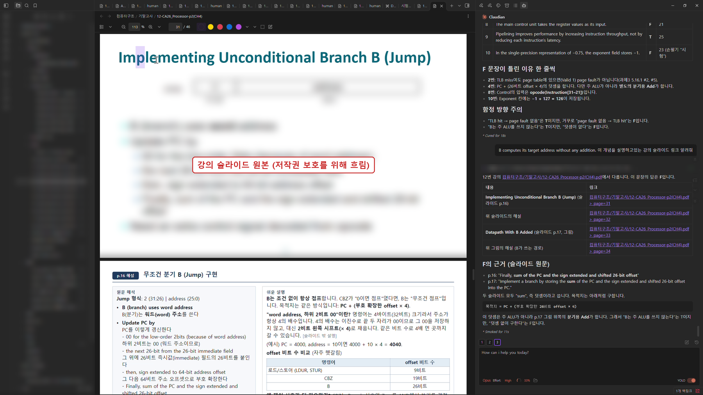

# AI Board Study Kit

**강의 PDF를 넣으면, AI가 나만의 문제집으로 바꿔 주는 Obsidian + Claude Code 학습 환경.**
공부할 과목 폴더에서 명령 한 줄이면 설치됩니다.

```bash
# macOS · Linux · Windows Git Bash
curl -fsSL https://raw.githubusercontent.com/IBORY-PURPLE/ai-board-study-kit/main/install.sh | bash
```

```powershell
# Windows PowerShell
irm https://raw.githubusercontent.com/IBORY-PURPLE/ai-board-study-kit/main/install.ps1 | iex
```

2026학년도 가천대학교 생성형 AI 활용 사례 공모전(학습 분야) 출품작 "AI Board"의 학습 환경을 누구나 쓸 수 있게 공개한 것입니다. 실제로 컴퓨터구조 기말고사를 4일 동안 이 환경으로 준비했습니다.

## 무엇이 되나

| 기능 | Claudian 창에 이렇게 말하면 | 결과 |
|---|---|---|
| 지식베이스 | "강의자료 폴더로 지식베이스 만들어줘" | 강의 PDF 전체를 블록 단위(원문·쉬운 설명·출제 형식·T/F 함정)로 정리 |
| 슬라이드 질문·필기 | "이 슬라이드 설명해줘" → "PDF에 필기해줘" | 지금 보는 쪽을 읽고 답한 뒤, 그 문장에 하이라이트 메모로 남김 |
| **내 자료 직접 고치기** | "이 예시도 표로 그려서 여기 붙여줘" | 내 보고서·필기 원본을 고쳐 PDF를 다시 만듦. 그 표가 그대로 표 채우기 문제지가 됨 |
| **슬라이드 원문 링크** | "이 개념 설명하는 슬라이드 링크 알려줘" | 누르면 해당 쪽이 바로 열리는 링크 표 + 원문 인용. AI 답을 원문으로 바로 검증 |
| 시험쪽집게 | "이거 시험에 나온다. 쪽집게 추가해줘" | 출제 예상 문항 누적. AI가 설명 중 짚은 시험 포인트도 자동으로 쌓임 |
| 해설 페이지 | "이 강의 슬라이드마다 해설 넣어줘" | 슬라이드 바로 다음 쪽에 한국어 해설 페이지를 끼워 넣음 |
| 퀴즈·모의고사 | "쪽집게로 T/F 퀴즈 만들어줘" | 한 문제씩 풀고 정답·해설·근거 슬라이드를 보는 HTML 퀴즈 |

### 핵심 기능 1. 내 자료를 대화 한 번으로 고치기



### 핵심 기능 2. 문제에서 강의 슬라이드 원문으로 바로 가기



(강의 슬라이드는 저작권 보호를 위해 흐림 처리했습니다.)

## 설치되는 것

```
과목 폴더/
├─ CLAUDE.md            AI 공통 규칙 (질문 처리, PDF 필기, 원본 보호)
├─ AGENTS.md            학습 에이전트 규칙 (지식베이스, 원문 링크, 자료 고치기, 쪽집게, 해설, 퀴즈)
├─ 강의자료/             ← 강의 PDF를 여기에 넣는다
├─ 지식베이스/지식베이스.md
├─ 시험쪽집게/시험쪽집게.md
├─ html필기노트/          AI가 만든 HTML 필기·퀴즈
├─ .tools/annotate_pdf.py   PDF 읽기·하이라이트 필기·글자 상자·표 그리기 (원본 자동 백업)
├─ .tools/insert_pages.py   슬라이드 다음 쪽에 해설 PDF 끼워 넣기
└─ .obsidian/plugins/    PDF++, Claudian (각 공식 GitHub 릴리스에서 내려받음)
```

- 이미 있는 파일은 덮어쓰지 않습니다. `CLAUDE.md`·`AGENTS.md`가 있으면 `*.study-kit.md`로 옆에 둡니다.
- PDF를 처음 고칠 때 원본은 `_pdf_원본백업/`에 자동으로 복사됩니다.

## 준비물

- [Obsidian](https://obsidian.md) (데스크톱)
- [Claude Code](https://docs.claude.com/en/docs/claude-code) — `npm install -g @anthropic-ai/claude-code` 후 로그인
- Python 3 + PyMuPDF — 설치 스크립트가 없으면 `pip install --user pymupdf`를 시도합니다

## 시작하기

1. 공부할 과목 폴더에서 위 설치 명령을 실행합니다.
2. `강의자료/`에 강의 PDF를 넣습니다.
3. Obsidian에서 "폴더를 보관함으로 열기"로 이 폴더를 열고, 플러그인 사용을 허용합니다.
4. 오른쪽 Claudian 창에 `강의자료 폴더로 지식베이스 만들어줘. 너는 나의 시험 학습 에이전트야.`
5. `AGENTS.md` 맨 위 `과목 정보`(시험 범위·일시)를 채우면 더 정확해집니다.

## 주의

- 강의자료는 본인 공부용입니다. 강의 슬라이드 원본을 공개 저장소나 웹에 올리지 마세요.
- AI의 답은 틀릴 수 있습니다. 그래서 이 키트는 모든 답에 `파일 p.N` 근거와 원문 링크를 붙이게 합니다. 확인되지 않은 내용은 `확인 필요`로 표시됩니다.

## 사용한 오픈소스

- [PDF++](https://github.com/RyotaUshio/obsidian-pdf-plus) — Ryota Ushio
- [Claudian](https://github.com/YishenTu/claudian) — Yishen Tu (MIT)
- [PyMuPDF](https://github.com/pymupdf/PyMuPDF)

플러그인은 이 저장소에 포함하지 않고, 설치할 때 각 프로젝트의 최신 공식 릴리스에서 내려받습니다.

## 라이선스

MIT © 2026 AI Board
